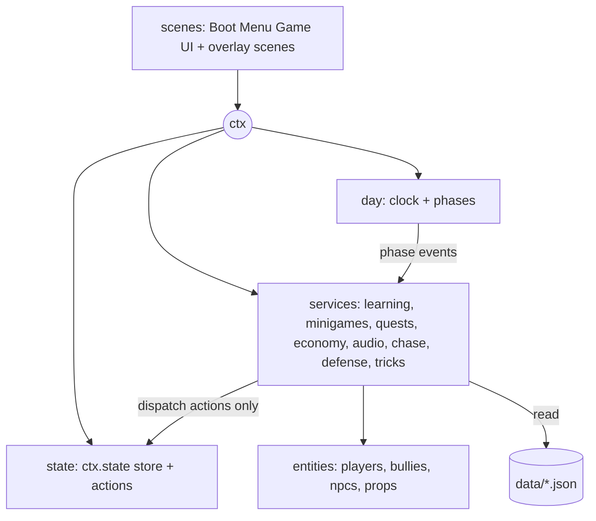

# Architecture Spine — Schulweg Game (Klasse 3)

## Design Paradigm

**Event-driven services over a shared `ctx`, one state store, data-driven content.** The prototype's pattern (AD-2) stays: scenes host services, services talk through `ctx.events`. The new systems add one owner of persistent state (`ctx.state`), one owner of time (`ctx.day`), and content in JSON.



Dependency rule (extends the prototype's): scenes → ctx/services → entities → data. Only `state/` writes saved data, and only through actions. Services never import each other; they use `ctx.events`.

## Inherited Invariants

| Inherited | From parent | Binds here |
| --- | --- | --- |
| AD-1 No build step, ES modules | architecture-schulweg-prototype | every new file |
| AD-2 One `ctx`, event-coupled systems | same | all new services |
| AD-3 Collision categories, tools affect props only | same | tools, karate, skating, new bodies |
| AD-4 Movement from profiles | same | skateboard, skates, vehicles |
| AD-5 ASCII-grid map | same | districts, interiors |
| AD-6 Surfaces service | same | seasons, grind surfaces |
| AD-7 Wind | same | new projectiles, particles |
| AD-8 Pooling, culling, sleeping | same | all new entities |
| AD-9 Quality tiers | same | new effects, audio voices |
| AD-10 Input intent snapshot | same | per-player intents, new actions |
| AD-11 Text only through `ctx.t` | same | all new text |
| AD-12 Chase director and bully FSM | same | levels 3–5, chasers |
| AD-13 Scene layout | same | overlay scenes |
| AD-14 Frame/render budget | same | all new work |
| AD-15 Pedestrians pooled | same | crowd extras |

## Invariants & Rules

### AD-16 — One state store, actions only, versioned saves [ADOPTED: 3 slots, autosave per phase]
- **Binds:** CAP-2, CAP-6, CAP-8, CAP-10, CAP-11, CAP-12, CAP-16, CAP-18, CAP-24, CAP-25, CAP-27, CAP-28
- **Prevents:** scattered saved data, incompatible save shapes, and systems mutating each other's state.
- **Rule:** `ctx.state` (`state/GameState.js`) is the only owner of saved data and has a numeric `v`. Mutation happens only through registered actions (`state/actions.js`, `ctx.state.dispatch(name, payload)`), which emit `state:changed` carrying the changed path. Sections: `shared` (money in integer cents, familienfrieden, owned vehicles, quests, clock, flags) and `players[i]` (character, attributes, xp/level, grades, learning stats, karate belt, cosmetics, stickers, bag). Slots are `localStorage` keys `schulweg.save.1`–`3`; settings keep their own keys (`schulweg.lang`, `schulweg.quality`, `schulweg.audio`, `schulweg.parent`). Saves happen on `phase:ended` and on explicit save, never mid-phase; world positions are not saved. A `migrate(from)` chain upgrades older `v`; an unreadable slot is copied to `schulweg.save.<n>.bak` and reported, never thrown.

### AD-17 — The day clock owns time, phase, season and weather schedule
- **Binds:** CAP-2, CAP-3, CAP-4, CAP-5, CAP-30
- **Prevents:** several systems keeping their own clocks or switching phases.
- **Rule:** `services/DayClock.js` (`ctx.day`) is the only owner of game time and the phase machine `morning → commute → school → afternoon → evening`, configured in `data/day.json` (seconds per game minute, phase windows, season and weather schedule). Phases advance only through `ctx.day.advance(reason)`; the clock emits `clock:tick`, `phase:started`, `phase:ended`. `Weather` reads the schedule from the clock. Overlays and minigames freeze the world with `ctx.frozen` and never move the clock unless the data says so.

### AD-18 — Players are an array; intents are per player [ADOPTED: local co-op, shared camera]
- **Binds:** CAP-1, CAP-5, CAP-12, CAP-23, CAP-26
- **Prevents:** singleton-player assumptions that break co-op, and two inputs fighting over one player.
- **Rule:** `ctx.players` is an array of players, each with an `index`; `ctx.player` is a compatibility alias for `players[0]` and is removed when `scripts/check-all.mjs` finds no uses. `ctx.input.intents[i]` is player i's intent snapshot (AD-10); `ctx.input.intent` aliases `intents[0]`. Bindings live in `data/input.json`: P1 keyboard WASD/Space/Shift/F/Q/E with mouse aim; P2 arrow keys with its own keys; P3 a third keyboard block (IJKL block); gamepads bind to the next free player slot. Up to three players are supported. Systems iterate `ctx.players` or call `ctx.nearestPlayer(x, y)`; events about a player carry `player: index`. A `CameraRig` keeps all players in view by zooming to fit within the AD-14 zoom range and enforces a tether distance from `data/camera.json`. Chase targets the nearest visible player; hiding, caught frames, pickups and zones are evaluated per player; the Ärger level is shared. HUD slices are per player, shared items appear once.

### AD-19 — One learning engine
- **Binds:** CAP-5, CAP-6, CAP-7, CAP-9, CAP-22, CAP-25
- **Prevents:** minigames, bullies or shops each inventing question handling, and statistics written in different shapes.
- **Rule:** Questions live in `data/learning/<grade>/<topic>.json`, each item `{id, topic, type, difficulty 1–5, q:{de,en}, answers, explain:{de,en}, hints}`; English items are bilingual. `learning/LearningEngine.js` (`ctx.learning`) exposes `next(topic, {player, context})`, `answer(question, ok, ms)` and `due(player)`. It alone writes per-topic stats (rolling accuracy, level, due queue) through state actions, steers difficulty toward 75–85% correct, and schedules wrong answers for repetition counted in answered questions. The parent difficulty setting (AD-27) scales it. Callers never read or write learning stats directly.

### AD-20 — Minigames share one framework
- **Binds:** CAP-5, CAP-7, CAP-10, CAP-18
- **Prevents:** minigames with their own pause, input, scoring or grading.
- **Rule:** `data/minigames.json` registers each minigame (`id`, `subject`, `scene`, `duration`, `rewards`). `ctx.minigames.start(id, {players, difficulty, context})` freezes the world, launches the scene on top and resolves to `{score 0–1, correct, total, xp, stats}`. Minigames read input only from intents (AD-10), support `players.length` of 1 or 2 side by side, and scale by quality tier. `grading/Grades.js` is the only code mapping a score to a German grade 1–6.

### AD-21 — Missions and chores run on one quest runner
- **Binds:** CAP-3, CAP-4, CAP-9, CAP-10, CAP-11, CAP-22
- **Prevents:** per-mission state machines and objectives the arrow and HUD cannot see.
- **Rule:** Definitions live in `data/missions/*.json`: `{id, kind: mission|chore, title key, triggers, steps[{id, objective key, completeWhen, marker}], rewards, fail}`. `missions/QuestRunner.js` (`ctx.quests`) advances steps only from `ctx.events`, stores progress in `state.shared.quests`, and exposes `activeObjective(player)` to the objective arrow and HUD. Custom behaviour lives only in `missions/handlers/<id>.js` with `onStart/onEvent/onUpdate` hooks.

### AD-22 — Economy, items and collectibles are data plus actions
- **Binds:** CAP-12, CAP-16, CAP-24, CAP-25
- **Prevents:** prices and rewards in code, and balances changed outside the store.
- **Rule:** Prices live in `data/shop.json`, items in `data/items.json`, stickers `{id, rarity, fact:{de,en}}` in `data/stickers.json`, cosmetics in `data/cosmetics.json`. Money changes only via the actions `wallet.earn(reason, cents)` and `wallet.spend(reason, cents)`. `ctx.cosmetics.apply(player)` is the only place that swaps player texture keys.

### AD-23 — Skating is profiles plus a trick service
- **Binds:** CAP-13, CAP-14, CAP-15, CAP-16
- **Prevents:** vehicle-specific branches and trick scoring done in several places.
- **Rule:** Skateboard and skates are profiles in `data/vehicles.json` (AD-4). `vehicles/TrickSystem.js` is a per-player service with states `ollie, grind, manual, stairs` and the Style combo, emitting `style:changed` and `style:banked` (which pay out through AD-22 actions). Rails, ramps, stairs and benches are map objects (AD-28); only `TrickSystem` reads their grind data. Bus and tram grabs use `grab-target` entities that expose their velocity. A player's active vehicle changes only via `player.setVehicle(id)`, checked against `state.shared` ownership.

### AD-24 — Tools stay object-only; karate is a separate non-violent module [ADOPTED: karate]
- **Binds:** CAP-17, CAP-18, CAP-19
- **Prevents:** any tool or karate effect that harms people or animals, and defense logic spread over bully code.
- **Rule:** The throwing stick and the close-range stick implement the existing `Tool` interface and affect only `PROP`/`STATIC` bodies (AD-3). `defense/DefenseController` is per player with states `IDLE, BLOCK, DODGE, KIAI` (cooldown), driven by the `defend` and `kiai` intents, and emits `defense:kiai {player, radius}`. Bullies answer through a non-physical `STUMBLE` state (scripted step back, no force, no damage); NPCs and animals only gasp. The karate belt lives in `state.players[i]` and its effects come from `data/karate.json`. No hit, injury or violence visuals exist.

### AD-25 — Chasers are data on the existing director
- **Binds:** CAP-20, CAP-21, CAP-22
- **Prevents:** a second chase system and chasers raising Ärger on their own.
- **Rule:** `data/chasers.json` defines each chaser (`id`, movement profile, FSM preset, perception, trigger event, exit conditions). `ChaseDirector` stays the only writer of the Ärger level (0–5) and the only spawner (`spawnChaser(id, reason)`), using per-level spawn lists in `data/chase.json`. The Hausmeister, ticket inspector, neighbor dog and angry neighbor spawn only from their trigger events. Boss traits are data flags read through `trait.*` hooks in the bully FSM. The minimap's spotted radius comes from `chaser.spotted` events.

### AD-26 — One procedural audio service
- **Binds:** CAP-29, CAP-33
- **Prevents:** per-system audio contexts, sound files, and audible output before a user gesture.
- **Rule:** `services/audio.js` (`ctx.audio`) creates its `AudioContext` lazily on the first user gesture; mobile stays muted until then. Sound is synthesized: music patterns per phase and season plus chase layers by Ärger level in `data/music.json`, and SFX recipes mapped from event names in `data/audio.json`. Game code emits events (for example `sfx:play`); it never touches Web Audio. Voices are capped by the quality tier and scheduling allocates nothing per frame. Volume and mute persist in `schulweg.audio`.

### AD-27 — UI layers and the parent gate
- **Binds:** CAP-26, CAP-28, CAP-25, CAP-8
- **Prevents:** UI code changing the world or state directly, and overlays fighting over input.
- **Rule:** `UIScene` is composed of HUD modules in `ui/hud/*.js` registered in `ui/hud/index.js`, each bound to a `playerIndex` or to shared state. Phone, minimap, Lernbuch, shops, Zeugnis and settings are screens on `ui/ScreenStack.js` (only the top screen receives input; each screen declares in data whether it freezes the world). `services/parentGate.js` guards parent settings with a math question and stores them under `schulweg.parent`; the learning engine and chase director read those settings. The UI changes state only by dispatching AD-16 actions.

### AD-28 — Maps and interiors
- **Binds:** CAP-4, CAP-5, CAP-3, CAP-9, CAP-15, CAP-18, CAP-31
- **Prevents:** divergent map object shapes and ad-hoc scene switching for interiors.
- **Rule:** Every map, including interiors (home, school, dojo, bakery, shops), is one file in `data/maps/` in the AD-5 format. `ctx.world.load(mapId, entry)` is the only way to switch maps; `door` objects emit `world:enter {map, entry}`. `data/object-types.json` lists every allowed object `type` and its fields (for example `rail`, `ramp`, `stairs`, `bench`, `door`, `dojo`, `shop`, `bakery`, `pfand-machine`, `bike-rack`, `tram-stop`, `sign`, `mission-trigger`); `scripts/check-map.mjs` validates every map against it. Players and pools persist across a switch.

### AD-29 — Every epic ships its own checks and budget run
- **Binds:** all
- **Prevents:** regressions going unseen and unmeasured performance claims.
- **Rule:** Each epic adds node checks for its pure logic (modules with no Phaser, named `*Logic.js` or `check-*.mjs`), registers them in `scripts/check-all.mjs`, and extends `scripts/smoke.js` with a scripted scenario. `scripts/check-content.mjs` lints all `i18n/` and `data/learning/` text for disallowed words. The benchmark scenarios are re-run per epic; Medium worst case stays ≤ 3 ms per update. Scripts clean up only the processes they start, by PID.

### AD-30 — Environment art is rendered from the map grid, not authored per tile
- **Binds:** CAP-34, CAP-4, CAP-31
- **Prevents:** hand-placed one-off art that drifts from the grid, and visual fixes that need map edits.
- **Rule:** The ground renderer builds transitions, shores and edge details from each tile's neighbours (surface ids from AD-6) at map load into the static ground texture; no per-frame redraw. Buildings, doors, fences, hedges and street furniture are drawn by one procedural environment art module (`scenes/EnvArt.js`) from tile and object data using the HiResArt palette and shading rules, with matching art for Low (1x) and Medium/High (2x). Doors are `door`, `dojo` or `shop` objects drawn with frame, steps and mat so they are recognisable; walls are never plain filled squares. Art changes must not change collision, pathfinding or map data.

### AD-31 — Lighting, post effects and the art bible (added 2026-11-08, epic 16)
- **Binds:** CAP-35, CAP-34, CAP-31, CAP-30, CAP-33
- **Prevents:** effects bolted on per system, blurry non-pixel lighting, per-frame allocation in the render path, and art that drifts from one style.
- **Rule:** One render module `render/` owns lighting and post effects: `render/LightMap.js` renders ambient darkness plus additive light sprites into a light render texture at the *base* resolution (480x270, posterized or dithered falloff so light edges stay pixel art) and multiplies it over the world camera; `render/PostFx.js` registers the WebGL `PostFXPipeline` passes (colour grade from the day clock tint, light bloom on emissive pixels, vignette, weather passes) on the world camera only, never on `UIScene`. Per-object shaders (wind sway, water) live in `render/pipelines/`, are registered once by `render/PostFx.js` and each has a Canvas/Low fallback (tween or animated tiles). Light sources, emissive parts and effect parameters are data (`data/lighting.json`, `data/postfx.json`) and are pooled; systems request lights through `ctx.lights` (add/move/release a handle), never by creating sprites. Shaders sample with nearest filtering and snap to the base pixel grid. Every pass has a quality-tier switch in `data/quality.json` and a Canvas/Low fallback (the old tint overlay). The art bible `docs/ART-BIBLE.md` and the project skill `.claude/skills/schulweg-pixel-art/` are binding for every art change: palette ramps, light direction (top-left sun), outline and dithering rules, silhouette rules against grid-aligned rectangles. AD-30 still holds: static art is built once at map load from grid and object data; animation lives in shaders, particles or pooled sprites. New always-on random visuals get an `...Off` test flag (`scripts/smoke/env.js`) so the seeded smoke test stays deterministic.

- **Built in story 16.2 (2026-11-09):** the light-map route stayed. `Light2D` was not adopted: it needs a normal map for every procedural texture, caps the lights per pass and lights the whole scene pixel-smooth, so the stepped pool look and the pooled-handle API would have been lost; the light map costs one 480x270 render texture and one stamp draw per visible light. API: `ctx.lights.add({ x, y, radius, color, intensity, flicker })` returns a handle `{ alive, move(x, y), set(props), release() }` or `null` (pool full or tier `maxLights` 0), `ctx.lights.mapActive` says whether the light map is drawing (outdoors, WebGL, tier `lightMap`). Fixed lights are data (`data/lighting.json` `sources`, by map object id); ambient is the day tint turned into a multiply colour (`ambientFor`: `strength`, `floor`, never darker than the floor, so night stays readable). Camera passes: `SchulwegBloom` (bright pixels only, scaled by darkness, so it is off by day) then `SchulwegGrade` (grade + vignette), parameters in `data/postfx.json`, switches per tier in `data/quality.json` (`lightMap`, `maxLights`, `postFx.grade/vignette/bloomTaps`). Low, Canvas (`?renderer=canvas`) and indoor maps keep the old tint overlay (`physics/Weather.js` hides it only while `ctx.lights.mapActive`).
- **Built in story 16.3 (2026-11-09):** `render/StreetLights.js` owns the fixed and moving lights, `LightMap` only draws. Fixed lights are data (`data/lighting.json`: `street.lamps` tile positions per map, `sources` lamp objects, `signs` shops and tram stops, each with a named `schedules` entry: on/off minute plus a per-light spread and a warm-up flicker of at most 2.5 Hz; pure maths in `render/lightMath.js` `lampLit`, `warmupLevel`, `fixedBudget`). Moving lights (headlight, tail light of every GrabTargets vehicle, bike lamp) follow `lightMap.dark`. Budget: fixed lights `maxLights - vehicles.reserve`, moving lights the reserve; all culled to the camera. The mood is the `tint` keyframes of `data/day.json` (cool dawn, golden, violet, blue night), shared by the light map and the Low/Canvas overlay; ambient `strength` 1.0. Lamp posts and lit heads are sprites (`street-lamp-<v>`, `street-lamp-lit-<v>`), so lamps also glow on Low.

- **Built in story 16.4 (2026-11-09):** cast shadows are one image per outdoor map (`render/Shadows.js`, a world system) drawn with the object pipeline `SchulwegShadow` (`render/pipelines/ShadowFx.js`, registered by `PostFx` via `OBJECT_PIPELINES`) with the MULTIPLY blend at depth `lighting.json` `shadows.depth` (above the ground bake and puddles, below every object, never on the UI camera). The texture is a base-resolution mask baked once at map load by the pure `render/shadowMath.js` (R tall casters: walls, tree canopies, booths; G low casters: fences, hedges, dumpsters; B the casters' footprint or an ambient-occlusion level; alpha 255). The sun is the `sun` keyframes of `data/day.json` (`sunAt`, `ctx.day.sun`): the shader samples the mask at `uv - offset` with four taps along the shift (a swept, dithered shadow), the offset is whole base pixels recomputed once per game minute, and the strength follows the light map's darkness (`fadeEnd`) and rain or snow. Nothing is redrawn per frame. Low, Canvas and indoor maps have no cast shadows; contact shadows are baked into the sprites by `Pen.shadow` (dithered ellipse) on every tier, and props carry a `prop-contact` image.

- **Built in story 16.6 (2026-11-10):** vegetation breaks the tile grid. A `tree` tile keeps lawn, a trunk with a root flare and a contact shadow in the ground bake (`env-trunk-<species>` from `scenes/EnvArt.js`); the crown is a sprite of its own (`render/Vegetation.js`, a world system; textures `veg-crown-<species>-<shape>-<look>` from `scenes/VegArt.js`, 3 species x 3 shapes x seasons, placement and fade maths in `render/vegetationMath.js`, data in `data/vegetation.json`). All crowns are one layer at `vegetation.json` `depth` (above every object, below the light map and the particles), so they batch into one draw call of the wind pipeline (crowns sorted by depth among the objects would break the batch for every neighbour: measured +100 percent frame time); a crown fades to `fade.alpha` while a kid or a chasing bully stands behind its trunk (north of the base line, inside the crown ellipse); its look follows `ctx.day.season`. Hedge tiles stand on lawn; each connected run is one lumpy mass drawn on a canvas of its own and cut into one frame per tile (`veg-hedge-<run>`), so the lumps overshoot the tile border and each tile still sorts by its own base line. Wind: the object pipeline `SchulwegWind` (`render/pipelines/WindFx.js`, in `OBJECT_PIPELINES`) shifts every texture row sideways by whole base pixels (zero at the base, growing with height: a lean along `ctx.wind.vector.x` plus a flutter that follows `ctx.wind.strength`; the same formula as `swayShift`); it runs on tiers with `windFx` (Medium, High); the crowns are frames of one equal-sized atlas (`veg-crowns`) and each sprite's phase rides in the red channel of its tint, so the pipeline (a `MultiPipeline`) needs no per-object uniforms. Hedge runs lean as one piece by a pixel on every tier (CPU). Low and Canvas nudge the crowns near the view by one pixel (`sway.lowAmp`). The cast-shadow mask is unchanged (the `shadows.tree` ellipse still stands for the crown).

- **Built in story 16.7 (2026-11-10):** building exteriors. Wall tiles keep their art in the ground bake (`scenes/BuildingArt.js`: roofs in tile, slate and flat with ragged edge lips, facades with window styles, curtains, gutters, drainpipes, ageing, shop fronts, plinths; keys `env-roof-<pal>-<material>-<edgeMask>`, `env-facade-<pal>-<style>-<curtain>`, overlays `env-pipe|age|vent|bin`); everything about a building comes from the pure `render/buildingMath.js` (buildings found by flood fill, a seed per building, a palette x roof look that no building within two tiles shares, per-tile dressing hashed from the seed). `render/Buildings.js` (a world system) lends eave and chimney images from a fixed pool to the chunks near the view (atlas `bld-atlas`, depth of the tile base line), hangs shop awnings in the layer `awningDepth` above the objects and lights the windows: `windowLit` (on 17:30 + spread, off 06:00 + spread, only occupied windows), a pooled pane image fades in, and on Medium and High the nearest lit windows take a warm light below the sill from `ctx.lights` (tier `windowLights`; the pool limit is `maxLights`, of which StreetLights uses `maxLights - reserve - windowLights`). Data: `data/buildings.json`. No Math.random; the display list is constant while playing.

## Consistency Conventions

| Concern | Convention |
| --- | --- |
| Naming | Ids, event names and keys follow the prototype (kebab ids, `domain:verb` events); data files are `data/<system>.json`, content folders `data/<system>/`; save keys are `schulweg.<area>`. |
| Data & formats | Money in integer cents; time in game minutes from `ctx.day`; every user-visible string is an i18n key; every content item has a stable string id. |
| State & cross-cutting | Saved data changes only via AD-16 actions; events about a player carry `player: index`; new systems log with `console.warn` and never throw in `update`. |

## Stack

| Name | Version |
| --- | --- |
| Phaser (includes Matter.js) | 3.90.0 |
| Web Audio API | browser built-in |
| Gamepad API | browser built-in |
| localStorage | browser built-in |
| Node (check scripts) | any current LTS |

## Structural Seed

```text
state/       # GameState.js, actions.js, migrations
services/    # quality.js (exists), DayClock.js, audio.js, parentGate.js, learning engine host
learning/    # LearningEngine.js
minigames/   # Minigame base + one scene per minigame
missions/    # QuestRunner.js, handlers/
defense/     # DefenseController (karate)
grading/     # Grades.js
vehicles/    # MovementController (exists), TrickSystem.js
data/        # day, minigames, missions/, learning/, shop, items, stickers, cosmetics, karate, chasers, music, audio, object-types
ui/          # hud/, ScreenStack.js, screens
```

Deployment and environments: unchanged from the prototype (static files, no backend, run with `npx serve .` or `python -m http.server`).

## Capability → Architecture Map

| Capability / Area | Lives in | Governed by |
| --- | --- | --- |
| CAP-1 | prototype modules | AD-1 to AD-15, AD-29 |
| CAP-2, CAP-3, CAP-4, CAP-5, CAP-30 | `services/DayClock.js`, `data/day.json`, maps | AD-17, AD-28 |
| CAP-6, CAP-9 | `learning/`, `data/learning/` | AD-19 |
| CAP-7, CAP-8 | `minigames/`, `grading/`, `ui/` screens | AD-20, AD-27 |
| CAP-10, CAP-11 | `missions/`, `data/missions/` | AD-21 |
| CAP-12, CAP-16, CAP-24, CAP-25 | `state/`, shop/items/stickers data | AD-16, AD-22 |
| CAP-13, CAP-14, CAP-15 | `vehicles/`, map objects | AD-23, AD-28 |
| CAP-17, CAP-18, CAP-19 | `tools/`, `defense/`, `data/karate.json` | AD-24 |
| CAP-20, CAP-21, CAP-22 | `ai/`, `data/chasers.json` | AD-25 |
| CAP-23 | `ctx.players`, `CameraRig`, `ui/input.js` | AD-18 |
| CAP-26, CAP-28 | `ui/hud/`, `ui/ScreenStack.js`, `services/parentGate.js` | AD-27 |
| CAP-27 | `state/` | AD-16 |
| CAP-29 | `services/audio.js` | AD-26 |
| CAP-31, CAP-32, CAP-33 | prototype systems, i18n, platform | AD-8, AD-11, AD-14, AD-29 |

## Deferred

- Balance values (prices, XP curves, grade thresholds), set by data during build and playtests.
- Map layouts and art for new districts and interiors.
- Boss bully design and the Klasse 3 timetable and curriculum content.
- PWA service worker details and offline asset strategy.
- Klassen 4–9, the new school district, and cross-year progression (see the spec backlog).
- Real-phone 60 FPS measurement; only the desktop proxy exists.
