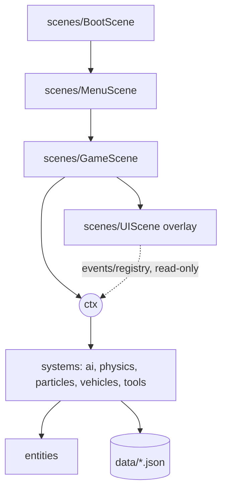

# Architecture Spine — Schulweg Prototype

## Design Paradigm

**Scene-hosted services over a shared context.** `GameScene` builds one `ctx` object holding services (`surfaces`, `wind`, `weather`, `quality`, `input`, `pools`, `chase`, `events`, `t`). Systems and entities receive `ctx`; they never import one another. Behaviour is tuned by JSON in `data/`; systems talk through `ctx.events`.



Dependency rule: scenes → ctx/services → entities → data. Services never import sibling services; entities never import scenes; `ui/` never mutates the world.

## Invariants & Rules

### AD-1 — No build step, native ES modules
- **Binds:** all
- **Prevents:** units adopting bundlers, `require`, or globals, so the game stops running from plain static files.
- **Rule:** `index.html` loads Phaser 3.90.0 from jsDelivr (exact version, never `latest`) then one `<script type="module" src="main.js">`. Every file uses `import`/`export` with explicit relative `.js` paths. No runtime npm dependencies. The only `window` property is `SCHULWEG_DEBUG`. The game must be served over HTTP (`file://` breaks modules).

### AD-2 — One `ctx`, event-coupled systems
- **Binds:** all
- **Prevents:** hidden coupling and two systems owning the same state.
- **Rule:** `GameScene` creates `ctx` once; each system is a class taking `ctx` and exposing `update(dt)`. Cross-system signals go through `ctx.events` using `domain:verb` names (`bully:bump`, `turf:enter`, `prop:hit`, `quality:changed`, `chase:level`). A fact has exactly one owning service; others read it.

### AD-3 — Collision categories and the tool-safety rule
- **Binds:** CAP-5, CAP-8, CAP-9
- **Prevents:** a tool or projectile ever affecting a person or animal.
- **Rule:** `physics/categories.js` defines bit categories `PLAYER, BULLY, NPC, ANIMAL, PROP, STATIC, SENSOR, PROJECTILE`. `PROJECTILE` masks only `PROP | STATIC`. All Matter bodies are created by `physics/bodies.js`, which sets `collisionFilter`; calling `matter.add.*` elsewhere is forbidden. Tool impulses and effects apply only to bodies whose category is `PROP`. Distractions travel as `prop:hit` events that bully AI may react to; they never apply force to people.

### AD-4 — Top-down movement from profiles
- **Binds:** CAP-1, CAP-2, CAP-3
- **Prevents:** per-vehicle special cases and gravity-based movement.
- **Rule:** Matter gravity is `{x:0,y:0}`. Controllers set velocity each frame from a movement profile in `data/vehicles.json` (`maxSpeed`, `accel`, `turnRate`, `grip`, `drift`, per-surface multipliers). Running is the profile `foot`. Code selects behaviour by profile data, never by comparing profile ids.

### AD-5 — Map is an ASCII-grid JSON
- **Binds:** CAP-3, CAP-4, CAP-5, CAP-6
- **Prevents:** two incompatible map representations (render grid vs. logic grid).
- **Rule:** `data/maps/town.json` holds `tileSize`, a `legend` mapping one char to a surface id or `wall`, `rows[]`, and an `objects[]` list (spawns, goal, hiding spots, bully turf, props, flags, bike). It is the single source for rendering, surface lookup, pathfinding walkability, and static wall bodies.

### AD-6 — Surfaces through one service
- **Binds:** CAP-3, CAP-8
- **Prevents:** scattered surface checks with different values.
- **Rule:** `ctx.surfaces.at(x, y)` returns the surface id (O(1) grid lookup). Properties (`grip`, speed multipliers per profile, `rattle`, particle name) live in `data/surfaces.json`. Weather may override a surface only inside this service.

### AD-7 — Wind is one vector, applied by each consumer
- **Binds:** CAP-8, CAP-9
- **Prevents:** wind applied twice or by a system that does not own the target.
- **Rule:** `ctx.wind.vector` is the only wind state. Particles, props tagged `windAffected`, flags and projectiles each read it and apply it themselves. The wind service never touches bodies or emitters.

### AD-8 — Pooling, culling, sleeping
- **Binds:** CAP-5, CAP-8, CAP-9, CAP-10
- **Prevents:** per-frame allocation and unbounded object counts.
- **Rule:** `entities/pools.js` registers each pooled kind with a cap taken from the active quality tier. No `add.sprite`, `add.particles`, or `new` of game objects inside `update` paths; use `ctx.pools.get(kind)` / `release`. Particle emitters are created once in `particles/` and fired via `ctx.particles.emit(name, x, y)`. Props outside camera plus margin sleep (Matter sleeping); NPC AI runs only within an active radius, chasers always run.

### AD-9 — Quality tiers
- **Binds:** CAP-10
- **Prevents:** systems with private performance knobs.
- **Rule:** `data/quality.json` defines Low/Medium/High multipliers and caps. Systems read them at spawn time and on `quality:changed`. The choice persists in `localStorage` key `schulweg.quality`; mobile defaults to Medium. `?q=low|medium|high` and `?debug` (FPS, body outlines) override at load.

### AD-10 — Input is an intent snapshot
- **Binds:** CAP-11, CAP-2, CAP-9
- **Prevents:** gameplay reading keys or pointers directly, which breaks mobile.
- **Rule:** `ui/input.js` merges keyboard, mouse, touch and gamepad into `ctx.input.intent = {move:{x,y}, aim:{x,y}|null, sprint, jump, interact, toolUse, toolNext, toolPrev, map, pause}` each frame, `aim` in world coordinates. No other module reads keyboard, pointer or gamepad.

### AD-11 — Text only through `ctx.t`
- **Binds:** all
- **Prevents:** hard-coded strings and diverging DE/EN key sets.
- **Rule:** All visible text is `ctx.t(key, params)` from `i18n/de.json` and `i18n/en.json`; keys are flat dot-case and both files carry identical key sets (checked by `scripts/check-i18n.mjs`, run with `node`). The language choice persists in `localStorage` key `schulweg.lang`. Signs drawn in the world stay German.

### AD-12 — Chase director and bully state machine
- **Binds:** CAP-5, CAP-6, CAP-7
- **Prevents:** several systems changing the Ärger level or inventing their own bully behaviour.
- **Rule:** `ai/ChaseDirector` is the only writer of the Ärger level (0–2) and the only spawner of bullies; others raise it through `ctx.events` (`bully:bump`, `turf:enter`). Each bully is a state machine with states `IDLE, CHASE, SEARCH, DISTRACTED, GIVE_UP, CAUGHT`. Perception is a line-of-sight ray cast against `STATIC` bodies; a hiding-spot `SENSOR` zone blanks sight while the player stands still inside. Pathfinding is grid A* over the AD-5 map with a shared budget of 2 requests per frame. The on-bike bully is a different movement profile, not a different state machine.

### AD-13 — Scene layout
- **Binds:** all
- **Prevents:** HUD logic leaking into world code and vice versa.
- **Rule:** Scenes are `BootScene` (preload JSON, generate procedural textures), `MenuScene` (language, quality, start), `GameScene` (world, owns `ctx`), `UIScene` (parallel overlay: HUD, touch controls, rotate hint). `UIScene` communicates only via `ctx.events` and the Phaser registry; it never mutates world state.

### AD-14 — Frame and render budget
- **Binds:** CAP-8, CAP-10
- **Prevents:** unmeasured performance claims and shimmering pixels.
- **Rule:** Target 60 FPS on Medium. Medium caps: ≤300 live particles, ≤60 awake props, ≤3 bullies, ≤12 NPCs. Internal resolution is set by the quality tier: 960×540 on Medium and High, 480×270 on Low (applied at load), scaled by an integer factor (letterboxed) with crisp, non-blurred scaling. Art is generated procedurally at the matching detail level. Matter uses a fixed timestep. Camera zoom ranges 0.6–1.0, is eased, and must not make sprites or tiles visibly jitter or swim (sub-pixel camera position and zoom-safe texture filtering, not per-frame pixel snapping while zooming).

### AD-15 — Pedestrians are pooled, event-driven NPCs
- **Binds:** CAP-12, CAP-5, CAP-8
- **Prevents:** NPCs with private spawning, physics or reaction code, and tools affecting them.
- **Rule:** `entities/Npc.js` actors come from the pool `npcs` (cap from `ctx.quality.maxNPCs`), use the `NPC` or `ANIMAL` category via the body factory, and are spawned and despawned only by `ai/CrowdDirector` using `npc-spawn` and path markers in the AD-5 map. Behaviour is a small state machine (`WALK, STAND, REACT, FLEE`) driven by data in `data/npcs.json`. Reactions to the player (`bike:bell`, close fast approach) are handled through `ctx.events`; NPC lines come from i18n keys. Tools never affect NPCs (AD-3).

## Consistency Conventions

| Concern | Convention |
| --- | --- |
| Naming | Files `kebab-case.js` except classes (`PascalCase.js`); ids, surfaces, profiles and event names are lowercase kebab or `domain:verb`. |
| Data & formats | JSON in `data/`; ids are strings; all tuning numbers live in `data/*.json`, not in code. Depth sort by `y`. |
| State & cross-cutting | State changes only inside the owning service; errors log with `console.warn` and never throw in `update`; `?debug` toggles overlays. |

## Stack

| Name | Version |
| --- | --- |
| Phaser (includes Matter.js; do not load separately) | 3.90.0 |
| JavaScript | ES2022 native modules |
| Dev server | `npx serve .` or `python -m http.server` (PowerShell) |
| Node (i18n check only) | any current LTS |

## Structural Seed

```text
index.html
main.js
scenes/        # Boot, Menu, Game, UI
entities/      # player, bully, npc, prop, pools.js
vehicles/      # profile loaders (data in data/vehicles.json)
tools/         # slingshot
ai/            # ChaseDirector, bully FSM, pathfinding
physics/       # categories.js, bodies.js, surfaces/wind services
particles/     # emitter registry
learning/ minigames/ missions/   # empty in prototype
i18n/          # de.json, en.json
data/          # vehicles, surfaces, quality, tuning, maps/town.json
ui/            # input.js, hud, touch controls
scripts/       # check-i18n.mjs
```

Deployment and environments: static files only, no backend. Phone testing: run `npx serve .` on the PC and open its LAN URL on the phone (Windows firewall may prompt).

## Capability → Architecture Map

| Capability / Area | Lives in | Governed by |
| --- | --- | --- |
| CAP-1, CAP-2 | `vehicles/`, `entities/player` | AD-4, AD-10 |
| CAP-3 | `physics/` surfaces service | AD-5, AD-6 |
| CAP-4 | `data/maps/town.json`, `scenes/GameScene`, `ui/` | AD-5, AD-13 |
| CAP-5, CAP-6, CAP-7 | `ai/` | AD-3, AD-12 |
| CAP-8 | `particles/`, `physics/`, `entities/prop` | AD-6, AD-7, AD-8 |
| CAP-9 | `tools/` | AD-3, AD-7, AD-10 |
| CAP-10 | `data/quality.json`, `scenes/MenuScene` | AD-8, AD-9, AD-14 |
| CAP-11 | `ui/input.js`, `scenes/UIScene` | AD-10, AD-13, AD-14 |

## Deferred

- Phaser 4 migration (4.2.1 is current on npm); revisit after the prototype if render performance needs it.
- Tiled-based map authoring, once maps outgrow hand editing.
- Audio, saves, learning/mission data schemas: out of prototype scope (see backlog).
- Camera zoom quantization if non-integer zoom looks bad.
- Automated tests; the prototype is checked by manual FPS protocol on the reference phone.
- Public hosting.
